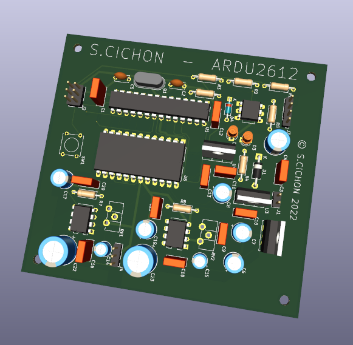

# ArduFM2612

[Polski](#polski) | [English](#english)

---

## Polski

Syntezator FM na prawdziwym układzie **Yamaha YM2612 (OPN2)**, tym samym co w Sega Mega Drive / Genesis. Bez emulacji: dźwięk robi krzem, a ATmega328P (jak w Arduino Uno/Nano) tylko tłumaczy MIDI na rejestry YM-a. Nie ma też żadnej kompensacji „ladder effect”, więc brzmi tak brudno jak oryginał.

Projekt zaczął się na breadboardzie z Arduino Nano i płytką MIDI z Amigi CDTV, a skończył na własnej płytce. W repo jest wszystko, żeby go powtórzyć: schemat i PCB (KiCad 6), Gerbery i firmware.

Demo: https://www.youtube.com/watch?v=h-EnhL6LnMI

### Co potrafi

- 6 kanałów FM, domyślnie 6-głosowa polifonia, MIDI w trybie omni.
- Sterownik obsługuje też inne przydziały głosów (mono z 6 kanałami w unisonie, 3×2, 2×3, splity). Tryb ustawia się w kodzie przez `setPlaymode()`.
- 48 brzmień w formacie VGI zapisanych we flashu, przełączanych z MIDI.
- Każdy parametr każdego operatora ma swój CC, więc zwykły kontroler z gałkami (u mnie Korg nanoKONTROL) staje się edytorem FM na żywo.
- Pitch bend, LFO na mod wheelu.

### Sprzęt

- ATmega328P, 16 MHz, złącze ISP do programowania.
- Zegar dla YM2612 (8 MHz) generuje Timer1 ATmegi na pinie D9, bez osobnego oscylatora.
- Wejście MIDI izolowane transoptorem CNY17-1.
- Wyjście stereo: dwa LM386 (L/P) z trymerami głośności.
- Trzy stabilizatory: 7809 dla LM386 oraz osobne 7805 dla analogowej i cyfrowej części. Zasilacz musi dać na tyle dużo, żeby 7809 za diodą zabezpieczającą miał zapas (w praktyce ok. 12 V DC).

Schemat: `Doc/sch.PNG`, lista części: `Board/bom.txt`.

### Mapa CC

| CC | Funkcja |
|----|---------|
| 1 | LFO (mod wheel) |
| 14 | Feedback |
| 15 | AMS |
| 16 | FMS |
| 17 | Algorytm |
| 18 | Panorama (0, 1, 2) |
| 20–30 | Operator 1 |
| 40–50 | Operator 2 |
| 60–70 | Operator 3 |
| 80–90 | Operator 4 |
| 112 / 113 | Poprzednie / następne brzmienie |
| 117 | Reset układu |

Kolejność parametrów w każdym bloku operatora (od pierwszego CC): AR, DR, SR, RR, TL, SL, MUL, DT, RS, SSG-EG, AM. Czyli np. CC 41 to Decay Rate operatora 2.

### Jak zbudować

1. Zamów płytkę z plików w `Gerber/` (spakuj folder do ZIP i wyślij do JLCPCB, PCBWay itp.).
2. Wlutuj części według `Board/bom.txt`. Najpierw sprawdź zasilanie bez włożonych YM2612 i ATmegi.
3. Zainstaluj w Arduino IDE bibliotekę **MIDI Library** (FortySevenEffects), otwórz `Firmware/ARDU2612.ino` i wgraj na ATmega328P (przez ISP albo w Arduino, a potem przełóż kość). Jest też projekt dla Visual Studio + Visual Micro.
4. Podłącz klawiaturę MIDI i graj.

Retro chipy kupuję z kilku źródeł naraz i testuję wszystkie, bo jakość YM2612 z rynku wtórnego to loteria.

### Znane ograniczenia i co bym dziś zmienił

- Velocity jest na razie ignorowane.
- Nuty są transponowane o +36 w `handleNoteOn` – jeśli strój nie pasuje, zacznij od tego miejsca.
- Dałbym sprzętowy generator 8 MHz zamiast zegara z Timer1. YM miałby zegar także podczas resetu i wgrywania firmware'u, a zwolniony pin D9 pozwoliłby ułożyć szynę danych tak, żeby bity pokrywały się z portami (D0–D1 na PB0–PB1, D2–D7 na PD2–PD7). Wtedy zapis do YM-a to dwie instrukcje zamiast ośmiu `digitalWrite()`.

### Licencje

- Oprogramowanie: MIT (`LICENSE-SOFTWARE-MIT.txt`)
- Sprzęt: CERN-OHL-P-2.0 (`LICENSE-HARDWARE-CERN-OHL-P-2.0.txt`)

Możesz używać do czego chcesz, także komercyjnie, byle z zachowaniem informacji o licencji.

Sławomir (Slav) Cichoń

---

## English

An FM synth built around a real **Yamaha YM2612 (OPN2)**, the chip from the Sega Mega Drive / Genesis. No emulation: the silicon makes the sound, and an ATmega328P (same as in an Arduino Uno/Nano) just turns MIDI into YM register writes. There is no "ladder effect" compensation either, so it sounds as gritty as the original.

It started on a breadboard with an Arduino Nano and a MIDI board pulled out of an Amiga CDTV, and ended up on its own PCB. This repo has everything you need to build one: schematic and PCB (KiCad 6), Gerbers and firmware.

Demo: https://www.youtube.com/watch?v=h-EnhL6LnMI

### What it does

- 6 FM channels, 6-voice polyphony by default, MIDI in omni mode.
- The driver also supports other voice modes (6-channel unison mono, 3×2, 2×3, splits). Pick one in code with `setPlaymode()`.
- 48 patches in VGI format stored in flash, switchable over MIDI.
- Every parameter of every operator has its own CC, so any knob controller (I use a Korg nanoKONTROL) works as a live FM editor.
- Pitch bend, LFO on the mod wheel.

### Hardware

- ATmega328P at 16 MHz, ISP header for programming.
- The YM2612 clock (8 MHz) comes from the ATmega's Timer1 on pin D9, no separate oscillator.
- MIDI input isolated with a CNY17-1 optocoupler.
- Stereo output: two LM386 (L/R) with trim pots for level.
- Three regulators: a 7809 for the LM386s and separate 7805s for the analog and digital sides. The supply needs enough headroom for the 7809 after the protection diode (about 12 V DC in practice).

Schematic: `Doc/sch.PNG`, parts list: `Board/bom.txt`.

### CC map

| CC | Function |
|----|----------|
| 1 | LFO (mod wheel) |
| 14 | Feedback |
| 15 | AMS |
| 16 | FMS |
| 17 | Algorithm |
| 18 | Pan (0, 1, 2) |
| 20–30 | Operator 1 |
| 40–50 | Operator 2 |
| 60–70 | Operator 3 |
| 80–90 | Operator 4 |
| 112 / 113 | Previous / next patch |
| 117 | Chip reset |

Parameter order in each operator block (starting at its first CC): AR, DR, SR, RR, TL, SL, MUL, DT, RS, SSG-EG, AM. So CC 41 is operator 2 Decay Rate, for example.

### Building it

1. Order the PCB from the files in `Gerber/` (zip the folder and upload it to JLCPCB, PCBWay etc.).
2. Solder the parts from `Board/bom.txt`. Check the power rails before you put in the YM2612 and the ATmega.
3. Install **MIDI Library** (FortySevenEffects) in the Arduino IDE, open `Firmware/ARDU2612.ino` and flash it to the ATmega328P (via ISP, or in an Arduino and then move the chip). There is also a Visual Studio + Visual Micro project.
4. Plug in a MIDI keyboard and play.

I buy retro chips from several sellers at once and test all of them. Second-hand YM2612s are a lottery.

### Known limitations and what I'd change today

- Velocity is ignored for now.
- Notes are transposed by +36 in `handleNoteOn`. If the tuning is off, start there.
- I'd use a hardware 8 MHz oscillator instead of the Timer1 clock. The YM would keep its clock during reset and flashing, and the freed D9 pin would let the data bus line up with the ports (D0–D1 on PB0–PB1, D2–D7 on PD2–PD7), so a register write takes two port writes instead of eight `digitalWrite()` calls.

### Licenses

- Software: MIT (`LICENSE-SOFTWARE-MIT.txt`)
- Hardware: CERN-OHL-P-2.0 (`LICENSE-HARDWARE-CERN-OHL-P-2.0.txt`)

Use it for anything you like, commercial use included, as long as you keep the license notices.

Sławomir (Slav) Cichoń
